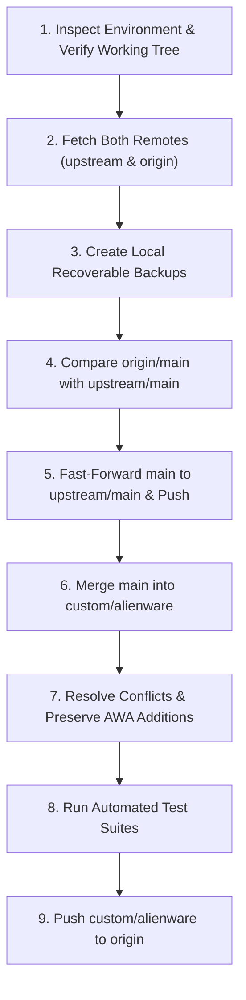

# Free Games Claimer — Fork & Upstream Maintenance Guide

> **Authoritative Handoff Guide for Human Maintainers and AI Coding Agents**
> Repository: `LoginRs99/free-games-claimer` (Fork)
> Upstream: `feldorn/free-games-claimer`
> Active Custom Branch: `custom/alienware`
> Base Tracking Branch: `main`

---

## 1. Repository & Branch Architecture

### Purpose and Components
This repository is a customized fork of [feldorn/free-games-claimer](https://github.com/feldorn/free-games-claimer). The application is an automated multi-storefront free games claimer and rewards farmer built with **Node.js** and **patchright** (anti-detection Chromium). It features:
- Automated storefront claiming: Epic Games Store, Amazon Prime Gaming, GOG, Steam, FAB.
- Points and rewards farming: Microsoft Rewards (desktop + mobile searches), AliExpress.
- Deal watchers: Humble Bundle, Fanatical, PSN, Xbox/Game Pass, IndieGala, Lenovo Gaming Key Drops, Ubisoft.
- Monolithic Web-UI Control Panel (`src/panel/panel.js` on port `:7080`) providing interactive cards, statistics, scheduler configuration, logs, discovery feeds, and alert notifications.
- Embedded noVNC server (`:6080`) for manual login and captcha solving.
- **Custom Alienware Arena (AWA) Module**: An integrated subsystem for daily Alienware Arena Control Center presence and automated Twitch stream watch-time farming.

### Remotes
- **`origin`**: `https://github.com/LoginRs99/free-games-claimer.git` — The maintainer's fork.
- **`upstream`**: `https://github.com/feldorn/free-games-claimer.git` — The original upstream repository maintained by `feldorn`.

### Branch Responsibilities
- **`main`**: **Strict Upstream Mirror.**
  - Represents the pristine upstream baseline without any custom Alienware or fork-specific changes.
  - Sourced directly from `upstream/main` via non-destructive fast-forward updates.
  - **Golden Rule**: Never commit Alienware-specific features, configurations, or ad-hoc modifications directly to `main`.
- **`custom/alienware`**: **Active Customized Branch.**
  - Contains all Alienware Arena automation, Twitch watch-time farming, custom scheduler loops, Web-UI integrations, documentation, and Alienware-specific fixes on top of the latest upstream code.
  - Deployed in Docker containers or server environments.

### Golden Rule for AI Agents
**Never assume branch state from past logs or recorded commit hashes.** Remote repositories evolve continuously. Always inspect the live Git remotes, branches, and working tree before planning or executing changes.

---

## 2. Alienware Customization Inventory

The Alienware customization is cleanly decoupled across four primary layers:

### A. Service Registry (`src/sites.js`)
- **Registry Entry (`alienware-arena`)**:
  - `id`: `'alienware-arena'`
  - `claimOrder`: `12` (runs outside the primary storefront chain)
  - `scheduleKind`: `'daily-window'`
  - `browserDir`: `browserDir('alienware-arena')` — isolated profile directory (`data/browser-alienware-arena/`) keeping AWA and Twitch cookies separate from other storefronts.
  - `configFields`: Schema definitions for all AWA settings rendered dynamically in **Settings → Services → Alienware Arena** (`AWA_ACTIVE`, `AWA_RUN_MODE`, `AWA_PRESENCE_MODE`, `AWA_PRESENCE_MINUTES`, `AWA_STREAMER_SELECTION_MODE`, `AWA_STOP_ON_TWITCH_CAP`, `AWA_DAILY_TARGET_MINUTES`, `AWA_ARP_TARGET`, `AWA_WATCH_CHUNK_MINUTES`, `AWA_TWITCH_RECHECK_MINUTES`, `AWA_TWITCH_STREAMERS`).
- **Tripartite Authentication Check (`checkLogin(page)`)**:
  - Probes `https://eu.alienwarearena.com/control-center`.
  - Detects explicit unauthenticated redirects (`/login`, `/account/login`).
  - Queries authenticated DOM indicators (`[data-is-logged-in="true"]`, `a[href="/quests"]`, `.user-avatar`).
  - Reads Twitch authentication cookies (`auth-token`, `login`) from the shared browser context.
  - Returns a structured tripartite contract:
    - `{ status: 'authenticated', loggedIn: true, user, details: { awa, twitch } }`
    - `{ status: 'unauthenticated', loggedIn: false, user, details: { awa, twitch } }`
    - `{ status: 'error', loggedIn: false, error }`
- **Result Normalization & Stale Verification**:
  - `normalizeLoginResult(result)`: Converts both modern tripartite results and legacy Boolean results into a normalized shape, ensuring errors/timeouts are never misclassified as unauthenticated.
  - `isSessionStale(result)`: Returns `true` strictly when a session is confirmed unauthenticated.

### B. Runner Automation (`src/platforms/alienware-arena.js`)
- **Lifecycle & Execution Modes (`AWA_RUN_MODE`)**:
  - `full` (Mode 1): Executes AWA presence farming followed by Twitch stream watch farming.
  - `presence` (Mode 2): Exclusively maintains AWA Control Center presence for daily Time on Site (TOS) ARP.
  - `twitch` (Mode 3): Exclusively watches eligible Twitch streams for daily Twitch ARP.
- **AWA Presence (`runAwaPresence`)**:
  - `auto_cap` mode: Checks Control Center every 5 minutes and automatically exits the moment daily Time on Site ARP reaches cap (`5/5 ARP`).
  - `fixed` mode: Runs for exact duration (`AWA_PRESENCE_MINUTES`).
- **Twitch Stream Farming (`runTwitchSessions`)**:
  - 2x Multiplier Extraction: Scrapes live Hive & Nexus partners directly from AWA Control Center (`live2xStreamers`).
  - Twitch Live Verification: Dual path — uses official Twitch Helix API if credentials are provided (`AWA_TWITCH_CLIENT_ID` / `AWA_TWITCH_CLIENT_SECRET`), or falls back to headless DOM inspection (`is offline` vs video player).
  - Stream Playback Optimization: Automatically mutes video audio (`mute.click()`) and hides heavy chat DOM elements (`chat.style.display = 'none'`) during stream playback loops.
  - Debounced Logout Detection: Warns and notifies once on Twitch logout during playback instead of flooding alerts.
  - Cap Auto-Stop: Checks `twitchUnderCap` on Control Center and terminates when the daily 25 ARP limit is achieved.
- **Persistence**:
  - Writes daily stats and session logs to `data/alienware-arena.json`.

### C. Web-UI Engine & Scheduler (`src/panel/panel.js`)
- **Independent Scheduler Loop (`awaSchedulerLoop`)**:
  - Identified in `INDEPENDENT_SCHEDULED_SITE_IDS = new Set(['alienware-arena'])`.
  - Runs in background according to `AWA_SCHEDULE_HOURS` and `AWA_SCHEDULE_START` (independent of the midnight main chain).
  - Uses `fireDetachedScheduledRun` with `postRun: () => postRunSessionCheck(['alienware-arena'])` to verify session health after completion.
- **Interactive Login & VNC (`launchSite`)**:
  - Opening the Alienware Arena session automatically opens a second browser tab at `https://www.twitch.tv/login`, enabling simultaneous authentication for both services in a single VNC session.
- **Session Verification (`verifyAndClose`, `checkSiteStatus`)**:
  - Normalized with `normalizeLoginResult`, mapping status cleanly to `logged_in`, `not_logged_in`, or `error` in UI cards.
- **Post-Run Session Check (`postRunSessionCheck`)**:
  - Evaluates session health with `isSessionStale(r)`. Skips network timeouts and errors so only confirmed unauthenticated sessions trigger Pushover notifications.
- **UI & Stats Cards**:
  - Custom card controls on Sessions tab (Run Mode modal, live background running pill).
  - Aggregated stats on Stats tab reading `alienware-arena.json`.

### D. Automated Test Suite (`test/alienware-check.js`)
- Validates the service registry definition, dual login, partial logins (AWA-only, Twitch-only), dual logout, login redirect detection, timeout error handling, tripartite normalization, and legacy format compatibility.

---

## 3. Repeatable Upstream Synchronization Procedure

Follow this safe, ordered workflow whenever a new upstream release or bug fix is published.



### Step 1: Pre-flight Verification
Ensure the working directory is correct and the working tree is clean:
```powershell
git status
git remote -v
```
If uncommitted or untracked changes exist, inspect and stash or commit them before proceeding.

### Step 2: Fetch Both Remotes
```powershell
git fetch upstream
git fetch origin
```

### Step 3: Create Recoverable Local Backups
Create timestamped backup branches before modifying any branch:
```powershell
$Date = Get-Date -Format "yyyyMMdd-HHmm"
git branch "backup/custom-alienware-before-sync-$Date" custom/alienware
git branch "backup/origin-main-before-sync-$Date" origin/main
```

### Step 4: Compare `origin/main` with `upstream/main`
Inspect incoming commits from upstream:
```powershell
git log --oneline origin/main..upstream/main
```
Verify that `origin/main` contains no unique, unmerged commits that would be lost.

### Step 5: Fast-Forward `main` Mirror
```powershell
git checkout main
git merge --ff-only upstream/main
git push origin main
```
*Note*: `main` must strictly match `upstream/main`. If `--ff-only` fails because `origin/main` diverged, stop and investigate before taking any destructive action.

### Step 6: Integrate Upstream Base into `custom/alienware`
Switch to the custom feature branch and merge the updated `main`:
```powershell
git checkout custom/alienware
git merge main -m "Merge branch 'main' into custom/alienware"
```
*Why Merge over Rebase?*
`custom/alienware` is an actively published remote tracking branch. Merging preserves public history, prevents forced pushes, makes upstream integration explicit, and avoids re-resolving previous merge commits.

### Step 7: Resolve Conflicts Deliberately
If conflicts arise (typically in `src/panel/panel.js` or `src/sites.js`):
1. **`src/sites.js`**: Preserve Alienware Arena's registry definition, `checkLogin`, `normalizeLoginResult`, and `isSessionStale`. Adopt upstream additions to other storefronts.
2. **`src/panel/panel.js`**: Preserve `INDEPENDENT_SCHEDULED_SITE_IDS`, `awaSchedulerLoop`, Alienware run endpoints, dual-tab login logic, and `isSessionStale` filtering in `postRunSessionCheck`. Adopt upstream core engine bug fixes and new tabs.
3. Complete the merge:
```powershell
git add .
git commit
```

### Step 8: Execute Validation Suites
Always run the test suites before publishing:
```powershell
node test/alienware-check.js
node test/url-security.js
node test/claim-cmd.js
npx eslint test/alienware-check.js --rule "@stylistic/linebreak-style: off"
```

### Step 9: Verify Ancestry & Publish
Confirm that `origin/custom/alienware` is an ancestor of local `custom/alienware`:
```powershell
git merge-base --is-ancestor origin/custom/alienware custom/alienware
git push origin custom/alienware
```
**Safety Check**: If Git demands a force-push (`--force`), stop immediately. Never force-push to a shared branch without explicit approval.

---

## 4. Regression & Validation Checklist

Before declaring an integration complete, verify each of the following components:

| Area | Check | Verification Method |
| :--- | :--- | :--- |
| **AWA Registry & Auth** | Dual login, partial login, logout, redirect, and errors handled accurately | `node test/alienware-check.js` (Automated) |
| **URL Security** | Upstream third-party URL sanitizer protects against SSRF and open redirects | `node test/url-security.js` (Automated) |
| **Claim Command Parsing** | Runner path normalization (`normalizeClaimCommand`) survives syntax variants | `node test/claim-cmd.js` (Automated) |
| **Sessions Tab UI** | Alienware card renders green dot on login, red dot on logout, error on failure | Web-UI inspection at `:7080` (Manual) |
| **Interactive Login** | Clicking "Login" on Alienware card opens both AWA and Twitch tabs | VNC inspection at `:6080` (Manual) |
| **Post-Run Verification** | Detached AWA runs trigger session check; timeouts do NOT alert | Automated contract tests + scheduler log |
| **Stream Playback** | Twitch stream runs with muted audio, hidden chat, and debounced logout notifications | Execution log / `alienware-arena.json` |
| **AWA Presence** | Auto-cap mode terminates as soon as 5/5 ARP is achieved | Execution log / Control Center DOM |

### Real-Browser vs. Mocked Testing
- **Automated / Mocked Verification**: Validates DOM selectors, cookie retrieval logic, status normalization, alert filtering, and error handling without external network dependencies.
- **Real Headful Session Verification**: Required for actual login credential persistence on `alienwarearena.com` and `twitch.tv`. Conducted via noVNC (`http://<host>:6080`) by opening the browser and completing SSO/captcha challenges manually.

---

## 5. Maintenance Rules & Known Risks

1. **Tripartite Authentication Contract**:
   Always maintain the three-state model:
   - `authenticated`: Verified active session.
   - `unauthenticated`: Definitively logged out (redirect to `/login` or missing auth indicators).
   - `error`: Network timeout, DNS failure, or DOM exception.
   **Crucial Rule**: Never classify `error` as `unauthenticated`. A network hiccup must never wake the user with an "expired session" notification.
2. **Profile Isolation**:
   Alienware Arena must continue using its dedicated browser profile directory (`data/browser-alienware-arena/`). Never point it to the default `data/browser/` directory used by Epic, Prime, and Steam.
3. **Upstream Monolith Evolution**:
   Upstream's `src/panel/panel.js` is large (~11,000+ lines). When upstream refactors scheduler loops, cookie imports, or auth checks, verify that Alienware's hooks (`awaSchedulerLoop`, `INDEPENDENT_SCHEDULED_SITE_IDS`, `/api/run-service`) remain cleanly connected.
4. **Twitch DOM & Anti-Bot Volatility**:
   Twitch frequently updates player overlay classes and stream status elements. If browser-based live detection fails, inspect `src/platforms/alienware-arena.js` (`isStreamerLive`) or configure official Twitch API keys in `.env` (`AWA_TWITCH_CLIENT_ID` / `AWA_TWITCH_CLIENT_SECRET`).
